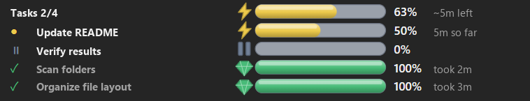
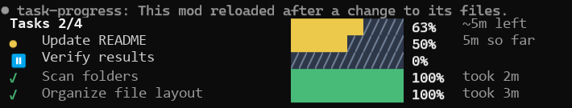

# task-progress

**English** | **[繁體中文](README.zh-TW.md)**

> Unofficial community project, not affiliated with Anthropic.

A Claude Code mod that shows a live **task progress panel** above the prompt: one progress bar per task, an overall percentage, and an estimated time remaining.

Desktop app (SVG graphical bars, `candy` style):



Terminal (character bars, `solid` style):



## Features

- One progress bar per task, with its status: pending ⏸, in progress ⚡, done 💎 (`candy` style on the desktop app).
- The header shows overall progress (`2/4`, `63%`) and the estimated time remaining.
- Shows how long each task took: "5m so far" while running, "took 2m" once finished.
- 10 bar styles, 5 icon sets, 3 layouts and 5 color themes, all selectable.
- Drawn as graphics (SVG) on the desktop app; the terminal automatically falls back to character styles with no extra setup.
- Fixed-width columns, so task names of different lengths (including CJK text) stay aligned.
- While Claude is working, an extra "Working" row at the bottom of the panel shows the real elapsed seconds and a sweeping highlight. Working time has no known total, so it never shows a fake percentage.
- When you send a new prompt, the tasks left over from the previous job are cleared automatically.
- Claude Code's built-in spinner text (for example `Unfurling… (56s · ↓ 5.6k tokens)`) gets the real task progress appended, e.g. `Unfurling… tasks 2/5, working 3/10 (56s · …)`.

## Install

Requires Claude Code 2.1.275 or newer.

In the Claude Code prompt:

```
/plugin install task-progress --marketplace elvis-ntu/claude-code-task-progress
```

Or in a shell:

```bash
claude plugin install task-progress --marketplace elvis-ntu/claude-code-task-progress
```

Choose the user scope when installing, so every project, the terminal and the desktop app's Code tab all load it.

After installing, run `/reload-plugins` or start a new session.

### Update

```bash
claude plugin marketplace update elvis-local
claude plugin update task-progress
```

Then run `/reload-plugins` or start a new session.

> For maintainers: Claude Code uses the `version` field in `.claude-plugin/plugin.json` to decide whether to fetch again. If you change the code without bumping the version, the cache keeps serving the old copy and your changes never load. Bump the version on every release.

## Usage

### 1. Check that it works

Type:

```
/task-progress demo
```

This loads 4 sample tasks and the panel appears above the prompt. To clear them:

```
/task-progress clear
```

### 2. Show real task progress

The panel can take its data from four sources. Whenever any of them updates a task, the panel appears automatically:

| Source | Description |
|---|---|
| `TodoWrite` | Claude's to-do list tool |
| `TaskCreate` / `TaskUpdate` | The newer task tools |
| `mcp__ccd_turn__update_plan` | The desktop app's built-in plan tool (sends the full list each time, with only titles and statuses) |
| `set_tasks` | This mod's own tool (`mcp__task-progress__set_tasks`). Claude sends the task list, and only the tasks that changed. An in-progress task **must** include both `total` (how many items in all) and `done` (how many are finished), or the call is rejected. It merges by default (matching on `title`); pass `reset: true` to clear old tasks |

Just ask Claude to do multi-step work and tell it to "track it with a to-do list", and the panel follows along. If Claude creates no tasks, no panel appears — that is normal.

### How progress is calculated

> Progress only updates when Claude reports it. A single long-running step (for example writing one huge file) leaves the number where it is until the step finishes, then it jumps. That is accurate, not a hang; the "Working" row at the bottom keeps showing elapsed seconds to prove it is still running. The finer the steps and the more often Claude reports, the smoother the bar.

Pending is 0%, done is 100%. For an in-progress task reported through `set_tasks`, the percentage is the real `done ÷ total` (capped at 99%; only completion makes it 100%), and the right side also shows the count such as `3/10`.

`set_tasks` **requires** `total` and `done` for in-progress tasks, so Claude must count the total (files, steps, items) before starting. If it can't be counted, the work has to be split into countable sub-steps first.

`TodoWrite`, `TaskCreate`/`TaskUpdate` and the desktop app's `update_plan` have no count fields. With them, an in-progress task has no real progress: the percentage column shows `—`, the bar stays empty, and it is excluded from the overall percentage, rather than pretending to be halfway. For a real progress bar, ask Claude to use `set_tasks`.

The overall percentage is the average across all tasks.

### Task order and retention

- Row order is fixed, following the order tasks were added; it does **not** jump around when statuses change.
- `set_tasks` **merges by default**: it matches existing tasks by `title`, and tasks it doesn't mention stay as they are. Finished tasks therefore stay on the panel instead of being overwritten by the next batch.
- When starting a brand-new job, Claude should pass `reset: true` to clear all the old tasks. You can also clear manually with `/task-progress clear`.
- When you send a new prompt, **all** tasks on the panel are cleared (finished or not), since a new prompt is a new job; Claude reports again whatever is still needed.
- With more than 6 tasks, only the latest 6 are shown, and earlier ones collapse into "N earlier tasks above".
- When the space above the prompt is short (for example, while running tools fill the screen), the panel shrinks instead of being cut off: it first drops the "Working" row, then lists only the tasks around the current one (the rest counted as "+N not shown" in the header), and with only one row left it switches to the one-line `compact` layout.

Estimated time remaining = average duration of finished tasks × remaining tasks. At least one task must be finished before it is shown.

## Configuring styles

Add `pluginConfigs` to `~/.claude/settings.json`. The key format is `task-progress@<marketplace name>`; this repo's marketplace name is `elvis-local` (set in `.claude-plugin/marketplace.json`):

```json
{
  "pluginConfigs": {
    "task-progress@elvis-local": {
      "options": {
        "language": "auto",
        "barStyle": "candy",
        "iconSet": "symbols",
        "layout": "detailed",
        "theme": "default",
        "trackStyle": "filled",
        "showWorking": "on",
        "spinnerProgress": "on"
      }
    }
  }
}
```

Run `/reload-plugins` to apply. Every field is optional; omitted ones use the defaults.

> This mod also declares these options as `userConfig`, so Claude Code's `/config` screen may offer dropdowns too. I haven't confirmed where they actually appear there; editing `settings.json` is the way known to work.

### Language `language`

| Value | Look |
|---|---|
| `auto` (default) | Follow Claude Code's own language setting if it exposes one, then the `LC_ALL` / `LC_MESSAGES` / `LANG` variables, then the system locale; English if none is recognized |
| `en` | English |
| `zh-TW` | 繁體中文 |

This changes everything the mod prints: the panel text, the `/task-progress` messages, the `set_tasks` result and the reminder attached to each prompt. If the panel shows the wrong language, set `language` explicitly.

### Bar style `barStyle`

| Value | Look | Works in |
|---|---|---|
| `solid` (default) | Solid color blocks | All |
| `blocks` | `█░` | All |
| `dots` | `●○` | All |
| `line` | `━─` | All |
| `segments` | `▰▱` | All |
| `ascii` | `[###---]` | All |
| `candy` | Glossy rounded bar with an icon on the left | Desktop |
| `stripes` | Rounded pill filled with diagonal-striped blocks | Desktop |
| `glossy` | Ten gradient blocks on a dark base | Desktop |
| `neon` | Dark tube bar with a glow effect | Desktop |

The last four are SVG graphics and can only be drawn by the desktop app (and the VS Code extension). In the terminal they automatically fall back to the closest character style: `candy` → `solid`, `stripes` and `glossy` → `segments`, `neon` → `line`.

### Icon set `iconSet`

| Value | Pending / In progress / Done |
|---|---|
| `symbols` (default) | ⏸ ● ✓ |
| `emoji` | ⏳ 🔄 ✅ |
| `circles` | ○ ◐ ● |
| `minimal` | `-` `>` `+` |
| `none` | No icons |

The `candy` style has its own icons: pending ⏸, in progress ⚡, done 💎, unaffected by `iconSet`.

### Layout `layout`

| Value | Look |
|---|---|
| `detailed` (default) | A header row plus one row per task, up to 6 rows |
| `compact` | One-line summary: overall progress, overall bar, current task |
| `header` | Only the overall progress line |

### Color theme `theme`

`default`, `ocean`, `sunset`, `neon`, `mono`.

### Working row `showWorking`

| Value | Look |
|---|---|
| `on` (default) | Show the "Working" row with elapsed seconds while Claude is busy |
| `off` | Show only tasks, no working row |

### Spinner progress `spinnerProgress`

| Value | Look |
|---|---|
| `on` (default) | Append task progress to the built-in spinner text; unchanged when there are no tasks |
| `off` | Leave the spinner text alone |

### Unfilled part style `trackStyle`

| Value | Look |
|---|---|
| `filled` (default) | Gray background. In the terminal, gray with `╱` hatching |
| `dashed` | Gray dashed line |

## Getting Claude to use `set_tasks`

The desktop app has its own built-in task tool (`update_plan`). If Claude isn't reminded, it may prefer the built-in one, and this mod will stay silent.

- The `set_tasks` tool description already says "prefer this one even if built-in task or plan tools exist", which Claude sees when choosing a tool.
- This mod **cannot** change the system prompt: in current Claude Code versions, the `prompt.compose` hook of a user-installed plugin is skipped by a built-in security plugin. That is a deliberate safeguard, so we don't work around it.
- Instead, on every prompt you send, the mod attaches one short fixed reminder next to it (via the `prompt.submit` hook's `context`). It is for the model only, you don't see it, and it does not read or change your own text. It is skipped for slash commands and in saver mode. In my tests (headless runs with this plugin loaded), Claude reported a 4-step job through `set_tasks` without being told to, in both runs. That is two runs, not a guarantee.
- The plugin also ships a skill, `track-progress`. Claude decides by itself whether to load a skill, and in a real session it did **not** load it, so don't rely on it alone.
- If the reminder above is not enough for you, add one line to your own `CLAUDE.md`, which both the terminal and the desktop app read (optional):

```
For multi-step work, count the total first and report progress with set_tasks, not update_plan.
```

## Token usage estimate

This plugin has very little effect on Claude's token usage. Below, "measured" and "estimated" figures are kept separate.

**What costs tokens** (all numbers are per occurrence):

| Item | When it is sent | Tokens | Source |
|---|---|---|---|
| The `set_tasks` tool definition | every request | about **273** | **Measured**: the MCP tools row in `/context` |
| The `track-progress` skill's entry in the skill list | every request | about 70 to 100 | **Estimated**: `/context` does not list it separately; inferred from the average of the other skills. Its full text (about 200) is sent only if Claude loads it |
| The fixed reminder attached to your prompt | once per prompt you send | about 30 to 50 | **Estimated**: one short Chinese sentence, not verified with a token counter. Not sent in saver mode or for slash commands |
| Claude calling `set_tasks` to report progress | once per report | about 150 to 300 | **Estimated**: not verified with a token counter |

**What costs nothing (0 tokens):** progress bars, animation, timers, spinner progress, styles and themes all run locally on screen and are never sent to the model. Reading task lists from `update_plan`, `TodoWrite` or `TaskCreate`/`TaskUpdate` is free too: those tools are already in the tool list, and the mod only uses the titles and statuses they already created.

### How to calculate it

```
requests × (273 + 70~100)   tool definition + skill entry
+ prompts  × 30~50        fixed reminder
+ reports  × 150~300        set_tasks calls
```

**Worked example:** you send 1 prompt, and Claude finishes the job in 10 requests, reporting progress 6 times.

| Part | Calculation | Tokens |
|---|---|---|
| Tool definition | 10 × 273 | 2,730 |
| Skill entry | 10 × 70 to 100 | 700 to 1,000 |
| Fixed reminder | 1 × 30 to 50 | 30 to 50 |
| Progress reports | 6 × 150 to 300 | 900 to 1,800 |
| **Total** | | **about 4,400 to 5,600 (roughly 5,000)** |

Only the 2,730 for the tool definition is measured; the rest are estimates. Two caveats: with prompt caching on, the repeated parts (tool definition, skill entry) are mostly billed at the cheaper cached rate; and text added to the conversation (the reminder, each report) is read again by every later request as part of the history, usually at the cached rate, which this example does not multiply out. Since each request already carries tens to hundreds of thousands of tokens of conversation, the fixed 273 + skill entry is roughly 0.1% of it.

These are token counts only; I have not converted them to money, because price depends on your model and plan. For actual spend, run `/cost` in Claude Code (pay-as-you-go) or `/usage` (subscription usage limits).

### How to reduce it

- **Report less often**: what accumulates is the number of reports, not the fixed 273. Report only between major steps, and send only the tasks that changed.
- **Prefer built-in task tools**: `update_plan` and `TodoWrite` add no cost, at the price of no real percentage for in-progress tasks.
- **Use saver mode when you don't need bars**: see the next section.

## Saver mode

The full description and parameter format of `set_tasks` (roughly 400 to 500 tokens, not verified with a counter) is attached to every request by default. To save that, type:

```
/task-progress saver
```

Each time you type it, it toggles on/off (you can also write `saver on` or `saver off` explicitly). When on, only the tool's name is in the request, and Claude loads the full definition with ToolSearch when needed. It takes effect from the next prompt, is remembered, and persists across sessions.

When to turn it on: sessions that mostly don't need a progress bar (Q&A, one-line edits). When not to: long jobs that report progress constantly — once loaded the definition stays in every request anyway, plus there's an extra loading step, so nothing is saved and Claude is also more likely to forget to use it.

This is a slash command and works in the terminal and the desktop app's Code tab. I haven't tested the web version (claude.ai/code), so I'm not sure whether plugin commands work there.

## Privacy and security

This plugin uses only the **task list** to draw the progress panel. Below is what it actually does and how you can verify it yourself.

**What it reads:** the tasks Claude creates with `update_plan`, `TodoWrite`, `TaskCreate`/`TaskUpdate` or `set_tasks` — that is, each task's **title** and **status** (pending, in progress, done).

**What it does not read:** your conversation, files, code, or command output. When you send a new prompt it does exactly one thing: clear the old tasks from the panel. It does not read the text of your prompt.

**What it does not do:**
- It does not use the network, and does not upload or send any data to anyone.
- It does not read or write your files, and does not run any commands.
- It does not call a model itself.

**You can verify it yourself:**
- All of the code is a single file, `hooks/register.tsx`, about 600 lines, which you can read directly.
- Run `claude plugin validate <folder>` and the engine lists every capability this plugin uses. Currently only: timers, reading the current time, registering the slash command and the `set_tasks` tool, reading and writing this session's task state, one local setting (the saver switch), and UI components. There are no file, command or network entries.
- The only data that persists is the `/task-progress saver` switch (one on/off value), stored in Claude Code's plugin storage. Tasks themselves live only in the current session.

**Two technical details, stated honestly:**
1. To recognize the desktop app's `update_plan`, this plugin registers a handler that runs on every tool call. It only looks at the tool's name; anything other than the task tools above is passed through unchanged, and the content of other tools is not read.
2. The code contains a `prompt.compose` handler that was meant to add a short "please use `set_tasks`" instruction to the system prompt. Current Claude Code versions skip it, so it does not run. Its replacement is the `prompt.submit` handler, which attaches the same fixed sentence next to each prompt as hidden context for the model. It adds only that constant text; it never reads or changes what you typed. If you're uneasy, you can delete either handler without affecting anything else.

## Troubleshooting

- **No panel at all**: first type `/task-progress demo`. If it appears, the mod works and there's just no task data right now; if not, run `/reload-plugins` and check that `claude plugin list` shows `task-progress`.
- **You typed it in Claude chat (claude.ai or the desktop app's Chat tab)**: the plugin loads only in Claude Code sessions, not the chat interface. Switch to the desktop app's **Code** tab.
- **`⏸` or the hatching shows as boxes, or widths are off**: your terminal font is missing glyphs. Switch to a font that supports them, or set `iconSet` to `minimal` and `barStyle` to `blocks`.
- **You see `task-progress: This mod reloaded after a change to its files.`**: this is Claude Code's normal notice after you edit the mod's files.

## Tested environment

Windows 11; the Claude Code terminal (CLI) and the Claude desktop app's Code tab, both working on two machines (home and office). `solid` (terminal) and `candy` (desktop) have been confirmed visually on screen. `stripes`, `glossy`, `neon`, the other character styles, and `emoji`, `circles`, `minimal`, `compact`, `header`, `dashed` have only passed type checks and SVG format checks and have not each been viewed on screen. macOS, Linux and the VS Code extension are untested. If you hit a problem, please open an issue with a screenshot.

## File layout

```
.claude-plugin/plugin.json        # plugin info and userConfig options
.claude-plugin/marketplace.json   # lets this repo be installed as a marketplace
hooks/hooks.json                  # points to the hooks module
hooks/register.tsx                # the mod itself
skills/track-progress/SKILL.md    # tells Claude to report with set_tasks
types/index.d.ts                  # state type declarations
docs/                             # screenshots for the README (*.en.png: English)
```

## License

[MIT](LICENSE)
