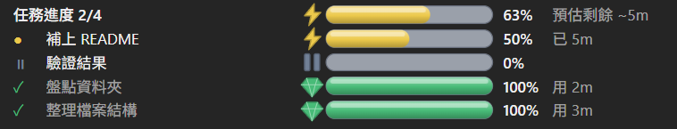
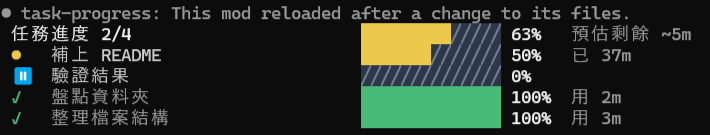

# task-progress

> 非官方專案：這是社群製作的 Claude Code plugin，與 Anthropic 無關。 / Unofficial community project, not affiliated with Anthropic.

> A Claude Code mod that shows a live progress panel above the prompt: one progress bar per task, an overall percentage, and an estimated time remaining.

在 Claude Code 輸入框上方顯示**任務進度面板**：每個任務一條進度條、整體完成百分比，以及預估剩餘時間。

桌面版（SVG 圖形進度條，`candy` 樣式）：



終端機（字元進度條，`solid` 樣式）：



## 功能

- 每個任務一條進度條，標示狀態：等待中 ⏸、進行中 ⚡、已完成 💎（桌面版 `candy` 樣式）。
- 標題列顯示整體進度（`2/4`、`63%`）與預估剩餘時間。
- 顯示每個任務花了多久：進行中顯示「已 5m」，完成後顯示「用 2m」。
- 10 種進度條樣式、5 種圖示組、3 種版面、5 種配色，全都可以自己選。
- 桌面版畫成圖形（SVG）；終端機自動退回字元樣式，不用另外設定。
- 欄位固定寬度，中文任務名稱長短不一也會對齊。

## 安裝

需要 Claude Code 2.1.275 或更新版本。

在 Claude Code 的輸入框執行：

```
/plugin install task-progress --marketplace elvis-ntu/claude-code-task-progress
```

或在終端機（shell）執行：

```bash
claude plugin install task-progress --marketplace elvis-ntu/claude-code-task-progress
```

安裝時選使用者層級（user scope），之後每個專案、終端機和桌面版的 Code 分頁都會載入。

安裝後執行 `/reload-plugins`，或開一個新的 session。

## 使用

### 1. 先確認它有在運作

輸入：

```
/task-progress demo
```

會載入 4 個範例任務，輸入框上方就會出現進度面板。清除請輸入：

```
/task-progress clear
```

### 2. 讓它顯示真正的任務進度

面板的資料來源有三種，任何一種有任務更新，面板就會自動出現：

| 來源 | 說明 |
|---|---|
| `TodoWrite` | Claude 的待辦清單工具 |
| `TaskCreate` / `TaskUpdate` | 新版的任務工具 |
| `set_tasks` | 這個 mod 自己提供的工具（`mcp__task-progress__set_tasks`），Claude 傳入完整任務清單；進行中的任務**必須**同時傳 `total`（總共幾件）和 `done`（已完成幾件），缺少會被拒絕；預設合併更新（用 `title` 對應），傳 `reset: true` 才清掉舊任務 |

只要請 Claude 做多步驟的工作，並說明「用待辦清單追蹤」，面板就會跟著更新。Claude 沒有建立任務時，面板不會出現，這是正常的。

### 進度怎麼算

待辦 0%、完成 100%。進行中的任務用 `set_tasks` 回報時，百分比是 `done ÷ total` 算出來的真實數字（上限 99%，完成後才變 100%），右側也會顯示 `3/10` 這樣的數量。

`set_tasks` 對進行中的任務**強制**要有 `total` 和 `done`，所以 Claude 開始工作前一定要先數出總量（檔案數、步驟數、項目數），數不出來就要先把工作拆成可數的子步驟。

`TodoWrite` 和 `TaskCreate`/`TaskUpdate` 本身沒有數量欄位，用它們時進行中的任務沒有真實進度：百分比欄顯示 `—`，進度條保持空的，也不計入整體百分比，不會假裝做到一半。想要真實進度條，請 Claude 用 `set_tasks`。

整體百分比是所有任務的平均。

### 任務的順序與保留

- 列的順序固定，依任務加入的先後排列，**不會**因為狀態改變而跳動。
- `set_tasks` 預設是**合併更新**：用 `title` 對應已存在的任務，沒提到的任務保持原樣。所以做完的任務會留在面板上，不會被下一批蓋掉。
- 開始一件全新的工作時，Claude 應傳 `reset: true`，清掉舊的所有任務。也可以用 `/task-progress clear` 手動清空。
- 任務超過 6 個時，只顯示最近的 6 個，較早的折疊成「前面還有 N 個較早的任務」。

預估剩餘時間 = 已完成任務的平均耗時 × 剩餘任務數。至少要有一個完成的任務才會顯示。

## 設定樣式

在 `~/.claude/settings.json` 加上 `pluginConfigs`。key 的格式是 `task-progress@<marketplace 名稱>`，這個 repo 的 marketplace 名稱是 `elvis-local`（寫在 `.claude-plugin/marketplace.json`）：

```json
{
  "pluginConfigs": {
    "task-progress@elvis-local": {
      "options": {
        "barStyle": "candy",
        "iconSet": "symbols",
        "layout": "detailed",
        "theme": "default",
        "trackStyle": "filled"
      }
    }
  }
}
```

改完執行 `/reload-plugins` 生效。每個欄位都是選填，沒填就用預設值。

> 這個 mod 也把這些選項宣告成 `userConfig`，所以 Claude Code 的 `/config` 設定畫面也可能有下拉選單。但我沒有確認過選單裡實際顯示的位置，確定能用的是改 `settings.json`。

### 進度條樣式 `barStyle`

| 值 | 效果 | 適用 |
|---|---|---|
| `solid`（預設） | 實心色塊 | 全部 |
| `blocks` | `█░` | 全部 |
| `dots` | `●○` | 全部 |
| `line` | `━─` | 全部 |
| `segments` | `▰▱` | 全部 |
| `ascii` | `[###---]` | 全部 |
| `candy` | 光澤圓角條，左邊有圖示 | 桌面版 |
| `stripes` | 圓角膠囊，裡面是斜紋方塊 | 桌面版 |
| `glossy` | 深色底的十格漸層方塊 | 桌面版 |
| `neon` | 深色管狀條，有發光效果 | 桌面版 |

最後四種是 SVG 圖形，只有桌面版（和 VS Code 擴充）畫得出來。在終端機裡選它們會自動退回最接近的字元樣式：`candy` → `solid`、`stripes` 和 `glossy` → `segments`、`neon` → `line`。

### 圖示組 `iconSet`

| 值 | 等待中 / 進行中 / 完成 |
|---|---|
| `symbols`（預設） | ⏸ ● ✓ |
| `emoji` | ⏳ 🔄 ✅ |
| `circles` | ○ ◐ ● |
| `minimal` | `-` `>` `+` |
| `none` | 不顯示圖示 |

`candy` 樣式有自己的圖示：等待中 ⏸、進行中 ⚡、完成 💎，不受 `iconSet` 影響。

### 版面 `layout`

| 值 | 效果 |
|---|---|
| `detailed`（預設） | 標題列加上每個任務一列，最多顯示 6 列 |
| `compact` | 單行摘要：整體進度、整體進度條、目前的任務 |
| `header` | 只顯示整體進度那一行 |

### 配色 `theme`

`default`、`ocean`、`sunset`、`neon`、`mono`。

### 未完成部分的樣式 `trackStyle`

| 值 | 效果 |
|---|---|
| `filled`（預設） | 灰底。終端機裡是灰底加 `╱` 斜線 |
| `dashed` | 灰色虛線 |

## 疑難排解

- **完全沒有面板**：先輸入 `/task-progress demo`。有出現代表 mod 正常，只是目前沒有任務資料；沒出現請執行 `/reload-plugins`，再確認 `claude plugin list` 裡有 `task-progress`。
- **是在 Claude 聊天（claude.ai 或桌面版的 Chat 分頁）裡輸入的**：plugin 只在 Claude Code 的 session 裡載入，聊天介面不會，要切到桌面版的 **Code** 分頁。
- **`⏸` 或斜線顯示成方框、寬度跑掉**：這是終端機字型缺字。換一個有支援的字型，或把 `iconSet` 改成 `minimal`、`barStyle` 改成 `blocks`。
- **畫面出現 `task-progress: This mod reloaded after a change to its files.`**：這是 Claude Code 在你改了 mod 檔案後的正常提示。

## 測試環境

Windows 11；Claude Code 終端機與桌面版 Code 分頁。`solid`（終端機）和 `candy`（桌面版）已經實際在畫面上確認。`stripes`、`glossy`、`neon`、其他字元樣式與 `emoji`、`circles`、`minimal`、`compact`、`header`、`dashed` 只通過型別檢查與 SVG 格式檢查，還沒有逐一在畫面上看過。macOS、Linux、VS Code 擴充都還沒測。如果遇到問題，歡迎開 issue 並附上截圖。

## 檔案結構

```
.claude-plugin/plugin.json        # plugin 資訊與 userConfig 選項
.claude-plugin/marketplace.json   # 讓這個 repo 能當 marketplace 安裝
hooks/hooks.json                  # 指向 hooks 模組
hooks/register.tsx                # mod 本體
types/index.d.ts                  # 狀態的型別宣告
docs/                             # README 用的截圖
```

## 授權

[MIT](LICENSE)
