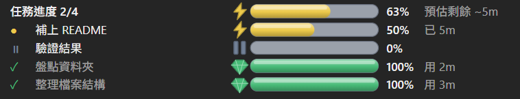
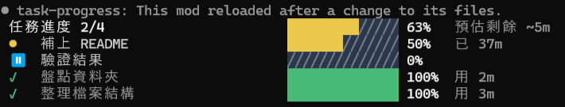

# task-progress

**[English](README.md)** | **繁體中文**

> 非官方專案：這是社群製作的 Claude Code plugin，與 Anthropic 無關。

在 Claude Code 輸入框上方顯示**任務進度面板**：每個任務一條進度條、整體完成百分比，以及預估剩餘時間。

桌面版（SVG 圖形進度條，`candy` 樣式）：



終端機（字元進度條，`solid` 樣式）：



## 功能

- 每個任務一條進度條，標示狀態：等待中 ⏸、進行中 ⚡、已完成 💎（桌面版 `candy` 樣式）。
- 標題列顯示整體進度（`2/4`、`63%`）與預估剩餘時間。
- 顯示每個任務花了多久，精確到秒：進行中顯示「已 3m5s」，完成後顯示「用 42s」。`set_tasks` 把任務標成完成時，對話裡的結果列也會列出每個完成的任務與耗時（例如「已更新 2 個任務；完成：修正程式（用 1m12s）」）。
- 10 種進度條樣式、5 種圖示組、3 種版面、5 種配色，全都可以自己選。
- 桌面版畫成圖形（SVG）；終端機自動退回字元樣式，不用另外設定。
- 欄位固定寬度，中文任務名稱長短不一也會對齊。
- Claude 處理中時，面板最下方多一列「處理中」，顯示真實經過的秒數和一段來回移動的亮塊。處理時間沒有總量可算，所以不給假的百分比。
- 你送出新的提問時，上一件工作留下的任務會自動清掉。
- Claude Code 內建的轉圈提示（例如 `Unfurling… (56s · ↓ 5.6k tokens)`）後面會接上真實的任務進度，變成 `Unfurling… 任務 2/5，進行中 3/10 (56s · …)`。

## 安裝

需要 Claude Code 2.1.275 或更新版本。

在 Claude Code 的輸入框執行：

```
/plugin install task-progress --marketplace elvis-ntu/claude-code-task-progress
```

或在終端機（shell）執行：

```bash
claude plugin install task-progress --marketplace elvis-ntu/claude-code-task-progress
```

安裝時選使用者層級（user scope），之後每個專案、終端機和桌面版的 Code 分頁都會載入。

安裝後執行 `/reload-plugins`，或開一個新的 session。

### 更新

第三方 marketplace 預設不會自動更新，沒打開的話不會收到新版，也不會有任何更新提醒。想自動收到更新：執行 `/plugin`，進 **Marketplaces** 分頁，選 `claude-code-task-progress`，把 auto-update 打開。之後 Claude Code 會在 session 開始後於背景檢查新版，裝好時顯示 `Plugin updated: … · Run /reload-plugins to apply`。

或手動更新：

```bash
claude plugin marketplace update claude-code-task-progress
claude plugin update task-progress
```

然後執行 `/reload-plugins`，或開一個新的 session。

> 給維護者：Claude Code 靠 `.claude-plugin/plugin.json` 的 `version` 判斷要不要重新抓取。改了程式卻沒升版號，cache 會一直用舊版，改動永遠不會載入。每次發佈都要遞增版號。

## 使用

### 1. 先確認它有在運作

輸入：

```
/task-progress demo
```

會載入 4 個範例任務，輸入框上方就會出現進度面板。清除請輸入：

```
/task-progress clear
```

想在對話裡看全部任務（不受面板高度和最多 6 列的限制）：

```
/task-progress list
```

### 2. 讓它顯示真正的任務進度

面板的資料來源有三種，任何一種有任務更新，面板就會自動出現：

| 來源 | 說明 |
|---|---|
| `TodoWrite` | Claude 的待辦清單工具 |
| `TaskCreate` / `TaskUpdate` | 新版的任務工具 |
| `mcp__ccd_turn__update_plan` | 桌面版 app 內建的計畫工具（每次傳完整清單，只有標題和狀態） |
| `set_tasks` | 這個 mod 自己提供的工具（`mcp__task-progress__set_tasks`），Claude 傳入任務清單，只需要傳有變動的任務；進行中的任務**必須**同時傳 `total`（總共幾件）和 `done`（已完成幾件），缺少會被拒絕；預設合併更新（用 `title` 對應），傳 `reset: true` 才清掉舊任務 |

只要請 Claude 做多步驟的工作，並說明「用待辦清單追蹤」，面板就會跟著更新。Claude 沒有建立任務時，面板不會出現，這是正常的。

### 進度怎麼算

> 進度只在 Claude 回報時才會更新。一個耗時很久的單一步驟（例如一次寫入一大份檔案）在做完之前，數字會停在原地，做完才一次跳上去。這是真實的，不是卡住；面板最下方的「處理中」列會持續顯示經過的秒數，證明它還在跑。步驟拆得越細、回報越勤，進度條就越平順。

待辦 0%、完成 100%。進行中的任務用 `set_tasks` 回報時，百分比是 `done ÷ total` 算出來的真實數字（上限 99%，完成後才變 100%），右側也會顯示 `3/10` 這樣的數量。

`set_tasks` 對進行中的任務**強制**要有 `total` 和 `done`，所以 Claude 開始工作前一定要先數出總量（檔案數、步驟數、項目數），數不出來就要先把工作拆成可數的子步驟。`total` 要數的是 Claude 會逐一完成並回報的單位：一次工具呼叫就做完的步驟（例如寫一支之後要處理 22 個檔案的腳本）是 `1`，不是 `22`，否則會一直停在 `0/22`，做完才一次跳到 100%。

`TodoWrite`、`TaskCreate`/`TaskUpdate` 和桌面版的 `update_plan` 本身沒有數量欄位，用它們時進行中的任務沒有真實進度：百分比欄顯示 `—`，進度條保持空的，也不計入整體百分比，不會假裝做到一半。想要真實進度條，請 Claude 用 `set_tasks`。

整體百分比是所有任務的平均。

### 任務的順序與保留

- 列的順序固定，依任務加入的先後排列，**不會**因為狀態改變而跳動。
- `set_tasks` 預設是**合併更新**：用 `title` 對應已存在的任務，沒提到的任務保持原樣。所以做完的任務會留在面板上，不會被下一批蓋掉。
- 開始一件全新的工作時，Claude 應傳 `reset: true`，清掉舊的所有任務。也可以用 `/task-progress clear` 手動清空。
- 你送出新的提問時，面板上的任務**全部清掉**（不論有沒有做完），因為新的提問就是新的一件工作；還需要的，Claude 會重新回報。
- 任務超過 6 個時，只顯示最近的 6 個，較早的折疊成「前面還有 N 個較早的任務」。
- 輸入框上方空間不夠時（例如執行中的工具佔滿畫面），面板會先拿掉「處理中」列。還是放不下但有 3 列以上時，完整清單可以捲動：下方會出現「↓ n more」，用滑鼠滾輪，或按 ctrl+x tab 聚焦面板後用方向鍵捲動。只剩 2 列時顯示標題列和目前的任務（其餘在標題列寫「另有 N 個未列出」），只剩 1 列時改用單行的 `compact` 版面。任何時候都可以用 `/task-progress list` 看全部任務。

預估剩餘時間 = 已完成任務的平均耗時 × 剩餘任務數。至少要有一個完成的任務才會顯示。

## 設定樣式

在 `~/.claude/settings.json` 加上 `pluginConfigs`。key 的格式是 `task-progress@<marketplace 名稱>`，這個 repo 的 marketplace 名稱是 `claude-code-task-progress`（寫在 `.claude-plugin/marketplace.json`）：

```json
{
  "pluginConfigs": {
    "task-progress@claude-code-task-progress": {
      "options": {
        "language": "auto",
        "barStyle": "candy",
        "iconSet": "symbols",
        "layout": "detailed",
        "theme": "default",
        "trackStyle": "filled",
        "showWorking": "on",
        "spinnerProgress": "on"
      }
    }
  }
}
```

改完執行 `/reload-plugins` 生效。每個欄位都是選填，沒填就用預設值。

> 這個 mod 也把這些選項宣告成 `userConfig`，所以 Claude Code 的 `/config` 設定畫面也可能有下拉選單。但我沒有確認過選單裡實際顯示的位置，確定能用的是改 `settings.json`。

### 語言 `language`

| 值 | 效果 |
|---|---|
| `auto`（預設） | 先看 Claude Code 自己的語言設定（若有提供），再看 `LC_ALL` / `LC_MESSAGES` / `LANG` 環境變數，最後看系統 locale；都認不出來就用英文 |
| `en` | English |
| `zh-TW` | 繁體中文 |

這會影響 mod 輸出的所有文字：面板文字、`/task-progress` 的訊息、`set_tasks` 的回傳，以及附在每個提問旁邊的提醒。如果面板的語言不對，請明確指定 `language`。

### 進度條樣式 `barStyle`

| 值 | 效果 | 適用 |
|---|---|---|
| `auto`（預設） | 桌面版用 `candy`，終端機用 `solid` | 全部 |
| `solid` | 實心色塊 | 全部 |
| `blocks` | `█░` | 全部 |
| `dots` | `●○` | 全部 |
| `line` | `━─` | 全部 |
| `segments` | `▰▱` | 全部 |
| `ascii` | `[###---]` | 全部 |
| `candy` | 光澤圓角條，左邊有圖示 | 桌面版 |
| `stripes` | 圓角膠囊，裡面是斜紋方塊 | 桌面版 |
| `glossy` | 深色底的十格漸層方塊 | 桌面版 |
| `neon` | 深色管狀條，有發光效果 | 桌面版 |

最後四種是 SVG 圖形，只有桌面版（和 VS Code 擴充）畫得出來。在終端機裡選它們會自動退回最接近的字元樣式：`candy` → `solid`、`stripes` 和 `glossy` → `segments`、`neon` → `line`。字元樣式在桌面版會改畫成單純的圓角 SVG 條，因為比例字型下字元進度條無法對齊。

### 圖示組 `iconSet`

| 值 | 等待中 / 進行中 / 完成 |
|---|---|
| `symbols`（預設） | ⏸ ● ✓ |
| `emoji` | ⏳ 🔄 ✅ |
| `circles` | ○ ◐ ● |
| `minimal` | `-` `>` `+` |
| `none` | 不顯示圖示 |

`candy` 樣式有自己的圖示：等待中 ⏸、進行中 ⚡、完成 💎，不受 `iconSet` 影響。

### 版面 `layout`

| 值 | 效果 |
|---|---|
| `detailed`（預設） | 標題列加上每個任務一列，最多顯示 6 列 |
| `compact` | 單行摘要：整體進度、整體進度條、目前的任務 |
| `header` | 只顯示整體進度那一行 |

### 配色 `theme`

`default`、`ocean`、`sunset`、`neon`、`mono`。

### 處理中列 `showWorking`

| 值 | 效果 |
|---|---|
| `on`（預設） | Claude 處理時顯示「處理中」列與經過秒數 |
| `off` | 只顯示任務，不顯示處理中列 |

### 轉圈提示 `spinnerProgress`

| 值 | 效果 |
|---|---|
| `on`（預設） | 在內建的轉圈提示後面加上任務進度；沒有任務時維持原樣 |
| `off` | 不修改轉圈提示 |

### 未完成部分的樣式 `trackStyle`

| 值 | 效果 |
|---|---|
| `filled`（預設） | 灰底。終端機裡是灰底加 `╱` 斜線 |
| `dashed` | 灰色虛線 |

## 讓 Claude 主動用 `set_tasks`

桌面版 app 有自己內建的任務工具（`update_plan`），Claude 沒被提醒的話可能會優先用內建的，這個 mod 就不會有動靜。

- `set_tasks` 的工具說明已經寫明「即使有內建的任務或計畫工具，也優先用這個」，Claude 選工具時看得到。
- 這個 mod **沒辦法**改系統提示：在目前的 Claude Code 版本，使用者安裝的 plugin 的 `prompt.compose` hook 會被內建的安全外掛跳過，這是刻意的防護，所以我們沒有繞過它。
- 改成：你每送出一個提問，mod 就在旁邊附上一句固定的短提醒（透過 `prompt.submit` hook 的 `context`）。這句只給模型看，你看不到，也不會讀取或修改你輸入的文字；斜線指令和省 token 模式不會附。我的實測（載入這個 plugin 的無頭模式）中，Claude 在沒有被特別指示的情況下，兩次都用 `set_tasks` 回報了 4 個步驟的工作。這只是兩次實測，不是保證。
  - 這句提醒也要求 Claude **讓進度條一路前進又不多花回合**：一次呼叫把整個任務列完，之後每完成一個步驟，就把它標完成、下一步標進行中，並附在下一批工具的同一回合送出（不單獨佔一個回合，也不拖到最後才一次回報）。和其他工具同一回合的 `set_tasks` 不會多出一個回合；只有單獨佔一個回合的呼叫，才會讓模型再重讀一次整段對話。
- 這個 plugin 另外附了一個 skill `track-progress`。skill 是否載入由 Claude 自己判斷，我在實際使用中它**沒有**載入，所以不要只靠它。
- 如果上面的提醒還不夠，可以另外在你自己的 `CLAUDE.md` 加一行（選用），終端機和桌面版都讀得到：

```
多步驟工作請先數出總量，並用 set_tasks 回報進度，不要用 update_plan。
```

## Token 用量預估

這個 plugin 對 Claude 的 token 用量影響很小。下面分成「量到的」和「估計的」，請分開看。

**會用到 token 的項目**（數字都是每次發生的量）：

| 項目 | 什麼時候送出 | token | 來源 |
|---|---|---|---|
| `set_tasks` 的工具定義 | 每次請求 | 約 **273** | **實測**：`/context` 的 MCP tools 那一列 |
| `track-progress` skill 在技能清單裡的條目 | 每次請求 | 約 70 到 100 | **估計**：`/context` 沒有單獨列出，是用其他 skill 的平均值推算。完整內文（約 200）只有 Claude 載入它時才會送出 |
| 附在你提問旁邊的固定提醒 | 你每送出一個提問一次 | 約 80 到 130 | **估計**：兩句短的中文（0.2.8 起加入分階段回報的提示），沒有用計數器驗證。省 token 模式與斜線指令不會附 |
| Claude 呼叫 `set_tasks` 回報進度 | 每次回報一次 | 約 150 到 300 | **估計**：沒有用計數器驗證 |

**不會用到 token（0）的項目：** 進度條、動畫、計時、轉圈提示上的任務進度、樣式與配色，全都在本機畫面上執行，不會送給模型。讀取 `update_plan`、`TodoWrite`、`TaskCreate`/`TaskUpdate` 的任務清單也是 0：這些工具本來就在工具清單裡，mod 只是用它們已經建立的任務標題與狀態來畫面板。

### 怎麼算

```
請求次數 × (273 + 70~100)   工具定義 + skill 條目
+ 提問次數 × 30~50        固定提醒
+ 回報次數 × 150~300        set_tasks 呼叫
```

**計算範例：** 你送出 1 個提問，Claude 用 10 次請求完成，過程中回報 6 次進度。

| 項目 | 算法 | token |
|---|---|---|
| 工具定義 | 10 × 273 | 2,730 |
| skill 條目 | 10 × 70 到 100 | 700 到 1,000 |
| 固定提醒 | 1 × 30 到 50 | 30 到 50 |
| 進度回報 | 6 × 150 到 300 | 900 到 1,800 |
| **合計** | | **約 4,400 到 5,600（大約 5,000）** |

只有工具定義的 2,730 是實測，其餘都是估計。兩點補充：開了 prompt caching 時，重複出現的部分（工具定義、skill 條目）多半以較便宜的快取價計算；另外，加進對話的文字（固定提醒、每次回報）會成為歷史的一部分，後面每次請求都會再讀到，通常以快取價計算，這個範例沒有把它們乘進去。以每次請求本來就帶著幾萬到幾十萬 token 的對話內容來看，固定的 273 加 skill 條目大約只佔 0.1% 上下。

這些都只是 token 數量，我沒有換算成金額：價格取決於你用的模型和方案。想知道實際花費，請在 Claude Code 裡執行 `/cost`（按用量計費），或 `/usage`（訂閱方案的用量額度）。

### 怎麼降低

- **別讓回報單獨佔一個回合**：真正會累積的是回合數，不是 273 的固定成本。每次回報都附在下一批工具呼叫裡，並且只傳有變動的任務。內建的提醒已經這樣要求（整個任務一次列完、每完成一步就更新、一律與其他工具同一回合）。
- **成本真正在哪**：和其他工具同一回合的 `set_tasks` 幾乎不增加成本；單獨佔一個回合的呼叫，會讓模型再重讀整段對話（通常是較便宜的快取價）。實際上這種單獨呼叫只占一個 session 用量的一小部分：看得到，但遠小於超長 session 與 sub-agent 的成本。我沒有量過通用的數字。
- **優先用內建的任務工具**：`update_plan`、`TodoWrite` 不會增加任何成本，代價是進行中的任務沒有真實百分比。
- **不需要進度條時開省 token 模式**：見下一節。

## 省 token 模式

`set_tasks` 的完整說明和參數格式（粗估 400 到 500 token，沒有用計數器驗證）預設會附在每一次對話請求裡。想省的時候，輸入：

```
/task-progress saver
```

每輸入一次就切換開／關（也可以明確寫 `saver on`、`saver off`）。開啟後，這個工具只有名字在請求裡，Claude 需要時才用 ToolSearch 載入完整定義；下一個提問起生效，設定會記住，換 session 也保留。

什麼時候適合開：這個 session 大多不需要進度條（問答、改一行程式）。什麼時候別開：長任務、會一直回報進度，因為載入後定義還是會留在每次請求裡，還多了一次載入，省不到，Claude 也比較容易忘記用它。

這個指令是斜線指令，在終端機和桌面版的 Code 分頁都可以用。網頁版（claude.ai/code）我沒有測過，不確定 plugin 的指令是否可用。

## 隱私與安全

這個 plugin 只拿**任務清單**來畫進度面板，下面是它實際做的事，以及你怎麼自己驗證。

**它讀什麼：** Claude 用 `update_plan`、`TodoWrite`、`TaskCreate`/`TaskUpdate` 或 `set_tasks` 建立的任務，也就是每個任務的**標題**和**狀態**（待辦、進行中、已完成）。

**它不讀什麼：** 你的對話內容、檔案、程式碼、命令的輸出。你送出新提問時，它只做一件事：把面板上的舊任務清掉，不會讀你提問的文字。

**它不做什麼：**
- 不連網，不上傳或傳送任何資料給任何人。
- 不讀寫你的檔案，不執行任何命令。
- 不自己呼叫模型。

**你可以自己驗證：**
- 全部程式只有一個檔案：`hooks/register.tsx`，約六百行，可以直接讀。
- 執行 `claude plugin validate <資料夾>`，引擎會列出這個 plugin 用到的所有功能。目前只有：計時器、讀取目前時間、註冊斜線指令與 `set_tasks` 工具、讀寫這個 session 的任務狀態、一個本機設定值（省 token 開關）、畫面元件。沒有檔案、命令、網路的項目。
- 唯一會留存的資料是 `/task-progress saver` 的開關（一個開或關），存在 Claude Code 的 plugin 儲存空間。任務本身只存在這個 session 裡。

**兩個要誠實說明的技術細節：**
1. 為了認得桌面版的 `update_plan`，這個 plugin 掛了一個「每次工具呼叫都會經過」的處理程式。它只看工具的名稱，不是上面那幾個任務工具就原樣放行，不會讀其他工具的內容。
2. 程式裡有一個 `prompt.compose` 處理程式，原本是要在系統提示加一小段「請用 `set_tasks`」的指示。目前版本的 Claude Code 會把它跳過，所以不會執行。取代它的是 `prompt.submit` 處理程式：在每個提問旁邊附上同一句固定文字，當作只給模型看的隱藏上下文。它只加這句固定內容，不讀也不改你輸入的文字。如果你不放心，兩個處理程式都可以刪掉，不影響其他功能。

## 疑難排解

- **完全沒有面板**：先輸入 `/task-progress demo`。有出現代表 mod 正常，只是目前沒有任務資料；沒出現請執行 `/reload-plugins`，再確認 `claude plugin list` 裡有 `task-progress`。
- **是在 Claude 聊天（claude.ai 或桌面版的 Chat 分頁）裡輸入的**：plugin 只在 Claude Code 的 session 裡載入，聊天介面不會，要切到桌面版的 **Code** 分頁。
- **`⏸` 或斜線顯示成方框、寬度跑掉**：這是終端機字型缺字。換一個有支援的字型，或把 `iconSet` 改成 `minimal`、`barStyle` 改成 `blocks`。
- **畫面出現 `task-progress: This mod reloaded after a change to its files.`**：這是 Claude Code 在你改了 mod 檔案後的正常提示。

## 測試環境

Windows 11；Claude Code 終端機（CLI）與 Claude 桌面版的 Code 分頁，在家中與公司兩台電腦上都能正常使用。`solid`（終端機）和 `candy`（桌面版）已經實際在畫面上確認。`stripes`、`glossy`、`neon`、其他字元樣式與 `emoji`、`circles`、`minimal`、`compact`、`header`、`dashed` 只通過型別檢查與 SVG 格式檢查，還沒有逐一在畫面上看過。macOS、Linux、VS Code 擴充都還沒測。如果遇到問題，歡迎開 issue 並附上截圖。

## 檔案結構

```
.claude-plugin/plugin.json        # plugin 資訊與 userConfig 選項
.claude-plugin/marketplace.json   # 讓這個 repo 能當 marketplace 安裝
hooks/hooks.json                  # 指向 hooks 模組
hooks/register.tsx                # mod 本體
skills/track-progress/SKILL.md    # 提醒 Claude 用 set_tasks 回報進度
types/index.d.ts                  # 狀態的型別宣告
docs/                             # README 用的截圖
```

## 授權

[MIT](LICENSE)
